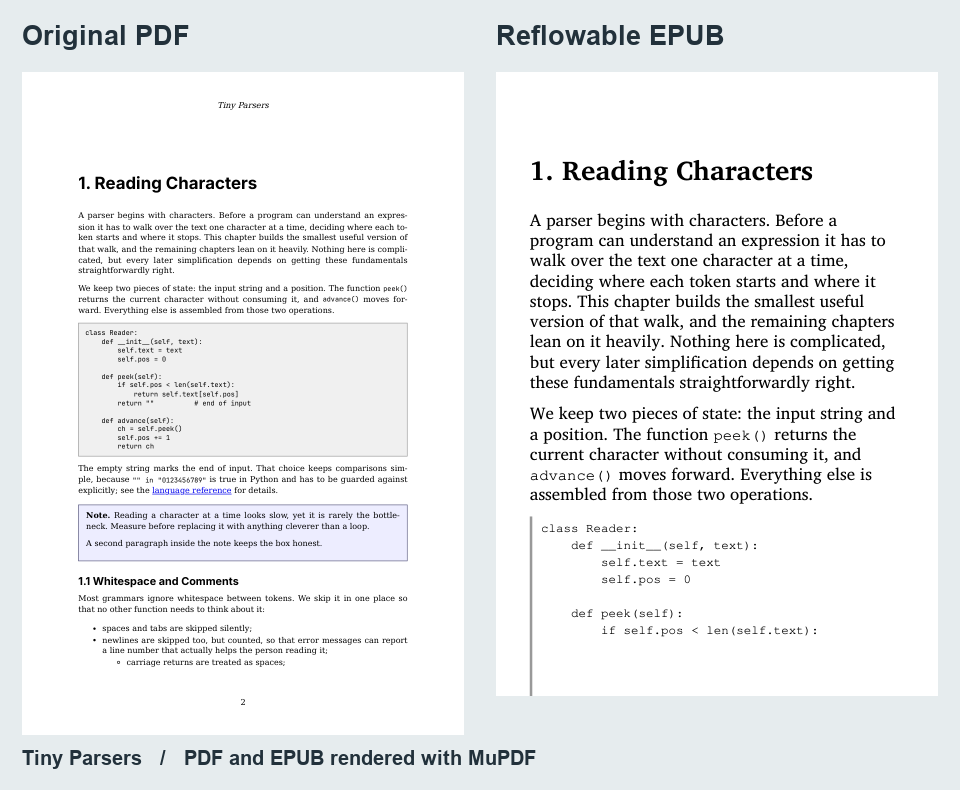
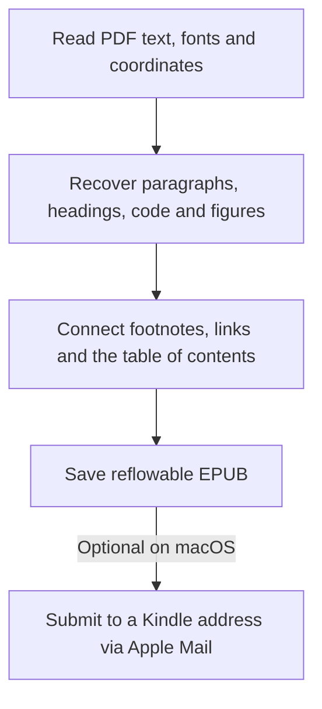

# pdf2kindle

**English** · [한국어](docs/README.ko.md)

Convert a single-column PDF with selectable text into a reflowable EPUB 3. Paragraphs wrap to the Kindle screen and respond to the reader’s font settings. Conversion runs locally.

Try *Tiny Parsers*, a short book included with the project. These renders show the same chapter in the PDF and the converted EPUB. [Original PDF](tests/fixtures/sample-outline.pdf) · [Download EPUB](docs/demo/tiny-parsers.epub?raw=1) · [Watch the font-size demo](docs/demo/reflow.gif) · [Upload to Kindle](https://www.amazon.com/sendtokindle)





## Quick start

Install with Python 3.10 or later, then convert a PDF.

```bash
git clone https://github.com/ccomkhj/pdf2kindle && cd pdf2kindle
python -m venv .venv && . .venv/bin/activate
python -m pip install -e .
pdf2kindle book.pdf
```

Find `book.epub` beside the PDF. To read it on Kindle, upload it through [Send to Kindle](https://www.amazon.com/sendtokindle). On macOS, you can also configure a sender in Apple Mail, approve its email address in Amazon’s Personal Document Settings, and run `pdf2kindle book.pdf --send-to reader@kindle.com` to convert and submit in one step.

## For agents

```bash
pdf2kindle convert book.pdf -o book.epub --report report.json
```

Check the exit code and the report’s `warnings` array. If delivery was requested and the EPUB already exists, run `pdf2kindle send book.epub --to reader@kindle.com`. A successful send command means Apple Mail accepted the request. Check Outbox and Sent before retrying. Confirm delivery when the book appears in the Kindle library.

## Conversion reference

| Content | How it is converted |
| --- | --- |
| Prose | Joins lines and paragraphs across pages, using vocabulary from the book to resolve end-of-line hyphens. Repeated running headers, footers and page numbers are removed. |
| Navigation | Uses PDF bookmarks or infers headings from typography. Builds a Kindle table of contents and drops printed contents pages and the index by default. |
| Code | Infers monospace fonts and reconstructs indentation and alignment from character positions. Wrapped lines use a hanging indent. |
| Figures and tables | Renders vector and bitmap figures, groups fragments near figure captions and emits HTML tables when the cell boundaries are clear. Complex tables become images. |
| Math | Preserves display equations as images and inline subscripts and superscripts as text. |
| Notes and links | Places margin notes near their paragraphs, links footnotes to matching markers and carries over internal and external links. |
| Other text | Preserves lists, definition lists, quotations and boxes. Recovers Korean spacing from glyph positions and word usage. |

Run `pdf2kindle convert --help` for all options.

| Option | Use |
| --- | --- |
| `--pages`, `--skip-pages` | Include or exclude ranges such as `1-3,10,200-`. |
| `--keep-index`, `--keep-toc-pages` | Keep the printed index or contents pages. |
| `--tables` | Choose `auto`, `html` or `image`. |
| `--no-footnotes` | Leave footnotes in the text flow. |
| `--cover` | Use the first page with `auto`, supply an image path or choose `none`. |
| `--profile` | Load per-book settings from a TOML file. |
| `--report`, `--debug-pdf` | Save a JSON summary or a PDF annotated with layout classifications. |

## Tuning a book

1. Run `pdf2kindle inspect book.pdf` to inspect fonts, bookmarks and running headers.
2. Run `pdf2kindle book.pdf --debug-pdf debug.pdf` to see which lines became code, headings or footnotes.
3. For a screen-sized preview, install the extras with `python -m pip install -e ".[dev,preview]"` and run `playwright install chromium`. Then run `pdf2kindle preview book.epub --device paperwhite`. Available sizes are `kindle`, `paperwhite` and `scribe`.
4. Copy the example profile, adjust the settings and convert again with `pdf2kindle book.pdf --profile book.toml`. [Example profile](examples/book.toml)

## Implementation

| Module | Responsibility |
| --- | --- |
| `pdfdoc.py`, `stats.py` | Read character positions with PyMuPDF and measure fonts, spacing, margins and recurring headers. |
| `regions.py`, `layout.py`, `judge.py` | Locate figures, tables and boxes, then classify lines into content blocks. |
| `convert.py`, `finishing.py` | Process pages and resolve book-wide structure, paragraph continuations, hyphens, footnotes and links. |
| `epub.py`, `kindle.css` | Package the book as EPUB 3 and style it for reflow. |
| `debug.py`, `preview.py` | Inspect classifications and render device-sized previews. |
| `delivery.py` | Submit the finished EPUB through macOS Mail. |

## Validation and limitations

Run `pytest` with the development extras installed. The suite covers generated PDFs with and without bookmarks, layout classification, code fonts, tables and Korean spacing. Earlier validation across ten publicly available books and five initial samples found zero EPUBCheck errors. Physical Kindle rendering remains unverified.

- Scanned pages become images. Apply OCR first if you need reflowable text. [OCRmyPDF](https://github.com/ocrmypdf/OCRmyPDF)
- Multi-column layouts are unsupported. Bookmarks several pages away from their headings can land at a nearby location.
- Display equations keep their original size and may have a white background in dark mode. Many equation images can make an EPUB large. Complex inline math can lose detail.
- A Korean word split across lines can retain an extra space if it appears only once in the book.
- For code that wraps awkwardly on your device, try `code_wrap = "plain"` in a book profile.

## License

The project’s own code is licensed under the [Apache License 2.0](LICENSE). PyMuPDF is a required dependency with separate AGPL or commercial licensing terms. Review those terms when distributing the converter or running it as a service. [PyMuPDF licensing](https://pymupdf.readthedocs.io/en/latest/about.html#license-and-copyright)
