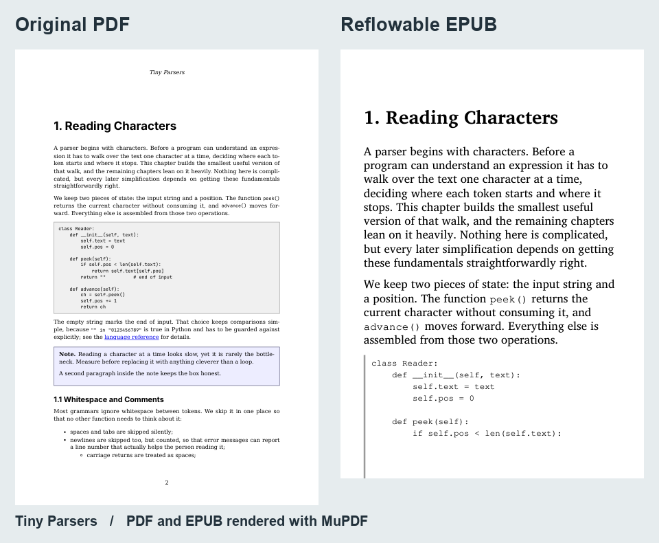
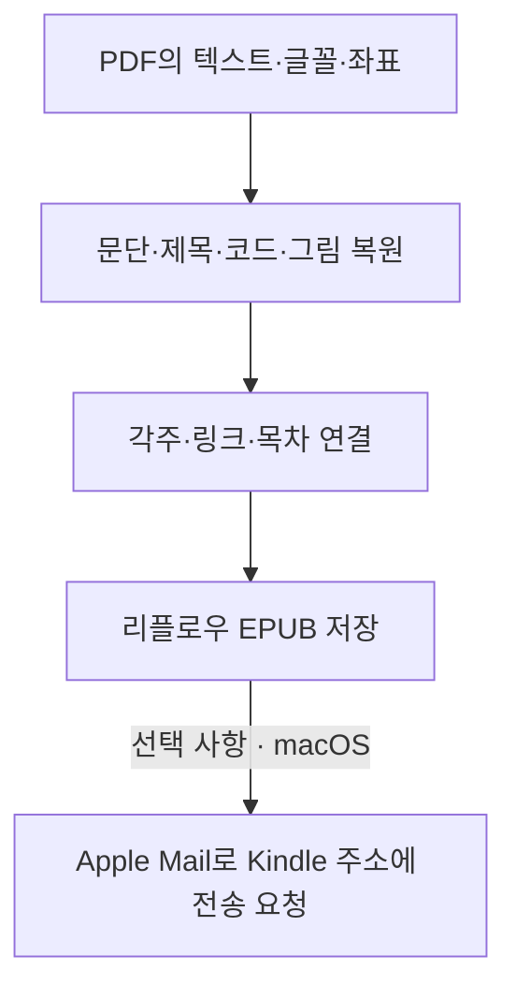

# pdf2kindle

[English](../README.md) · **한국어**

텍스트를 선택할 수 있는 단일 단 PDF를 Kindle에서 글자 크기를 조절하며 읽을 수 있는 EPUB 3 전자책으로 변환합니다. 변환은 로컬에서 실행됩니다.

## Claude Code 또는 Codex로 빠르게 시작하기

컴퓨터에서 Claude Code 또는 Codex를 열고 아래 프롬프트를 붙여넣으세요. 예제 URL을 변환할 PDF 링크나 내 컴퓨터에 있는 PDF 파일 경로로 바꿔도 됩니다. 파일 첨부를 지원하는 앱에서는 PDF를 첨부하고 프롬프트에서 해당 파일을 지정하세요.

```text
이 저장소의 변환기로 아래 PDF를 Kindle에서 읽을 수 있는 EPUB으로 만들어 줘.
https://github.com/ccomkhj/pdf2kindle

변환할 PDF
https://github.com/RavinRau/Ebooks/blob/main/Software%20Engineering%20Principle/The%20Pragmatic%20Programmer%20Your%20Journey%20to%20Mastery,%2020th%20Anniversary%20Edition%20by%20Andrew%20Hunt%20David%20Hurst%20Thomas.pdf

GitHub에서 원본 PDF를 내려받고 내 컴퓨터에 변환기를 설치해서 실행해 줘.
변환한 EPUB 파일과 Amazon Send to Kindle 업로드 링크를 알려 줘.
```

Kindle에서 사용하는 Amazon 계정으로 로그인해 변환한 EPUB을 업로드하세요. 그런 다음 Kindle을 동기화하고 라이브러리에서 책을 확인하세요. [Send to Kindle](https://www.amazon.com/sendtokindle)

<details>
<summary>Mac에서 이메일로 보내기</summary>

1. Amazon의 **Manage Your Content and Devices → Preferences → Personal Document Settings → Send to Kindle Email Settings**에서 기기의 Kindle 이메일 주소를 복사하세요. [Kindle 주소 찾기](https://digprjsurvey.amazon.com/csad/help/node/G7V489F2ZZU9JJGE)
2. Apple Mail에서 보낼 계정에 로그인하세요. Mail의 **보낸 사람** 주소를 Amazon의 **Approved Personal Document Email List**에 추가하세요. macOS에서 권한을 묻는 경우 Claude Code, Codex 또는 실행 중인 터미널이 Mail을 제어하도록 허용하세요. [발신 주소 승인하기](https://digprjsurvey.amazon.com/csad/help/node/GX9XLEVV8G4DB28H) · [Mail 자동화 허용하기](https://support.apple.com/en-au/guide/mac-help/mchl07817563/mac)
3. 아래 프롬프트에서 실제 Kindle 주소로 바꾼 뒤 같은 대화에 붙여넣으세요.

   ```text
   방금 만든 EPUB을 pdf2kindle과 Apple Mail로 YOUR_ADDRESS@kindle.com에 보내 줘.
   다시 보내기 전에 보낼 편지함과 보낸 편지함을 확인해 줘.
   Amazon 확인 이메일에서 내가 승인해야 하면 알려 줘.
   ```

4. Amazon에서 **“Verify your Send to Kindle document request”** 이메일을 보내면 48시간 안에 **Verify Request**를 누르세요. 그런 다음 Kindle을 동기화하세요. [Amazon 확인 절차](https://digprjsurvey.amazon.com/csad/help/node/G98WYFZBRHWGZACA)

메일이 **보낼 편지함**에 남아 있으면 **Mail → 윈도우 → 연결 진단**을 여세요. 발신 서버(SMTP)의 로그인에 실패했다면 **시스템 설정 → 인터넷 계정**에서 다시 로그인하세요. 연결이 복구되면 Mail이 대기 중인 메일을 보낼 수 있으니 다시 보내기 전에 **보낸 편지함**을 확인하세요. 메일이 발송됐는데 책이 보이지 않으면 받은 편지함과 스팸 폴더에서 Amazon의 확인 메일이나 오류 안내를 찾으세요. [Amazon 전송 오류 안내](https://digprjsurvey.amazon.com/csad/help/node/T48rsVm3gY7KeGkKUk)

</details>

## 변환된 EPUB으로 먼저 읽어 보기

프로젝트 예제인 *Tiny Parsers*입니다. 아래 이미지는 같은 장을 PDF와 EPUB에서 렌더링한 결과입니다. [원본 PDF](../tests/fixtures/sample-outline.pdf) · [샘플 EPUB](demo/tiny-parsers.epub?raw=1) · [글자 크기 변경 데모](demo/reflow.gif)



## 명령줄에서 사용하기

Python 3.10 이상에서 저장소를 설치하고 PDF를 변환하세요.

```bash
git clone https://github.com/ccomkhj/pdf2kindle && cd pdf2kindle
python -m venv .venv && . .venv/bin/activate
python -m pip install -e .
pdf2kindle book.pdf
```

원본 PDF 옆에 `book.epub`이 생성됩니다. macOS에서는 Apple Mail을 설정하고 Amazon에 발신 주소를 승인한 뒤 `pdf2kindle book.pdf --send-to YOUR_ADDRESS@kindle.com`으로 변환과 이메일 제출을 한 번에 할 수 있습니다.

## 에이전트용

```bash
pdf2kindle convert book.pdf -o book.epub --report report.json
```

종료 코드와 보고서의 `warnings`를 확인하세요. 사용자가 이메일 전송을 요청했고 EPUB이 이미 있다면 실제 Kindle 주소를 넣어 `pdf2kindle send book.epub --to YOUR_ADDRESS@kindle.com`을 실행하세요. 명령이 성공하면 Apple Mail이 전송 요청을 받은 상태입니다. 다시 보내기 전에 보낼 편지함과 보낸 편지함을 확인하세요. Kindle 라이브러리에 책이 나타나면 도착한 것입니다.

## 무엇을 해 주나

| 항목 | 처리 |
| --- | --- |
| 본문 | 줄바꿈을 문단으로 다시 합치고, 줄 끝 하이픈은 책 전체 어휘를 보고 판단 (`exam-ple` → `example`, `command-line`은 유지). 쪽을 넘어가는 문단도 이어 붙임 |
| 머리글·바닥글·쪽번호 | 여러 쪽에 반복되는 위치·문구를 찾아 제거 (각주와 본문 첫 줄은 보존) |
| 제목·목차 | PDF 북마크가 있으면 그대로, 없으면 글자 크기로 추정. Kindle "이동" 메뉴용 목차 생성. 인쇄용 목차 쪽과 색인은 제외 |
| 코드 | 글자 위치로 격자를 복원해 들여쓰기와 열 정렬 유지. 화면보다 긴 줄은 이어지는 부분을 들여써서 새 줄과 구분. PDF가 고정폭이라고 표시하지 않은 글꼴(Consolas 등)도 이름과 글자 폭으로 판별 |
| 수식 | 별행 수식(여러 줄 연립식, 행렬, 분수 포함)은 원본 그대로의 이미지로 보존. 본문 속 변수의 아래첨자·위첨자는 글자로 유지 |
| 표 | 격자가 확실할 때만 실제 표로, 아니면 원본 그대로의 이미지로 (잘못된 칸보다 이미지가 낫다는 원칙) |
| 그림 | 벡터·비트맵 그림 영역을 e-ink 해상도에 맞춰 렌더링. "Figure N:" 캡션이 있으면 그 위의 조각들을 한 그림으로 묶음 |
| 여백 주석 | 바깥 여백의 주석을 본문 줄에서 분리해, 옆에 있던 문단 뒤에 작은 글씨로 배치 |
| 한국어 | 공백 글리프가 없는 PDF에서 글자 간격으로 띄어쓰기 복원. 줄 끝에서 끊긴 단어는 책 전체 어휘를 보고 이어 붙임 |
| 각주 | 쪽 하단 각주를 본문 표식과 연결해 Kindle 팝업 각주로 |
| 링크 | 외부 URL과 문서 내부 상호참조("3.2절 참고")를 모두 유지 |
| 목록·정의 목록·인용·박스 | 구조 그대로 유지 |

글꼴·크기·정렬·색은 CSS에서 강제하지 않습니다. Kindle의 글꼴 설정과 다크 모드가 그대로 동작합니다.

## 변환 옵션

변환이 끝나면 요약이 출력됩니다. 경고(`!`)가 있으면 읽어 보세요.

```
'GAWK: Effective AWK Programming' -> gawk.epub
  pages                599
  chapters             27
  blocks               {'Code': 1064, 'Figure': 19, 'Heading': 467, 'ListItem': 757, 'Paragraph': 5135, 'Table': 15}
  footnotes            122
  footnotes_linked     121
  internal_links       1914
  ! 1 footnote(s) had no matching marker in the text; they are listed unlinked.
```

주요 옵션 (`pdf2kindle convert --help`):

| 옵션 | 뜻 |
| --- | --- |
| `--pages`, `--skip-pages` | 변환할/뺄 쪽. 예: `"1-3,10,200-"` |
| `--keep-index`, `--keep-toc-pages` | 색인, 인쇄용 목차 쪽을 남김 |
| `--tables auto\|html\|image` | 표 처리 방식 |
| `--no-footnotes` | 각주 연결을 끄고 본문 흐름에 둠 |
| `--profile book.toml` | 책별 설정 (`equations = false`로 수식 이미지화를 끌 수도 있음) |
| `--cover auto\|none\|파일` | 표지 (기본: 첫 쪽) |
| `--report r.json` | 변환 요약을 JSON으로 저장 |
| `--debug-pdf d.pdf` | 줄마다 무엇으로 판정했는지 그려 넣은 PDF 저장 |

## 책마다 다듬기

PDF는 만든 도구마다 생김새가 달라서, 결과가 어색하면 아래 순서로 원인을 찾고 프로필로 고칩니다.

1. **살펴보기** — `pdf2kindle inspect book.pdf`
   본문 글꼴, 고정폭으로 인식된 글꼴, 북마크, 머리글 감지 결과를 보여 줍니다.
2. **판정 확인** — `pdf2kindle book.pdf --debug-pdf debug.pdf`
   원본 위에 줄마다 판정(본문·제목·코드·각주·머리글·그림…)을 색으로 표시합니다.
   코드가 본문으로 잡혔는지, 머리글이 남았는지 한눈에 보입니다.
3. **미리보기** — `pdf2kindle preview book.epub --device paperwhite`
   Kindle 화면 크기와 쪽 넘김으로 렌더링한 PNG를 만듭니다 (`paperwhite`, `kindle`, `scribe`).
   Chromium 기반이라 실제 기기와 똑같지는 않지만 코드 줄바꿈, 그림 크기, 제목 위계를 판단하기엔 충분합니다.
4. **프로필 작성** — [`examples/book.toml`](../examples/book.toml)을 복사해 고칩니다.

```toml
mono_fonts = ["LetterGothic"]        # 고정폭 표시가 없는 코드 글꼴
drop_lines = ["Licensed to .*"]      # 쪽마다 찍힌 문구 제거
crop = [0.06, 0.0, 0.05, 0.0]        # 감지되지 않은 머리글·바닥글 영역 무시
skip_pages = "3-6"
tables = "image"                     # 이 책의 표는 전부 이미지로
```

## 동작 원리



OCR이나 레이아웃 모델로 글자를 "다시 읽지" 않습니다. 텍스트 레이어가 있는 PDF에는 정확한 글자와
글꼴·좌표가 이미 들어 있으므로, 그것을 그대로 쓰고 구조만 추론합니다. 그래서 오탈자가 생기지 않습니다.


| 모듈 | 역할 |
| --- | --- |
| `pdfdoc.py` | PyMuPDF로 글자 단위 좌표를 읽어 시각적 줄로 묶음 |
| `stats.py` | 본문 글꼴·행간·여백 측정, 머리글·바닥글 감지 |
| `regions.py` | 그림(벡터·비트맵), 표, 박스 영역 |
| `layout.py` | 줄을 제목·문단·코드·목록·각주로 분류 |
| `judge.py` | 줄 하나에 대한 판정(코드인가, 제목 글자 크기인가, 캡션인가)을 한 곳에서 답함 |
| `convert.py` | PDF를 열고 쪽마다 위 단계를 진행 |
| `finishing.py` | 책 단위 후처리: 제목 단계 확정, 색인 제거, 캡션, 쪽 간 병합, 각주, 줄 끝 단어, 내부 링크. PDF 없이 블록만으로 동작 |
| `epub.py`, `kindle.css` | EPUB 작성과 Kindle용 스타일 |
| `debug.py`, `preview.py` | 진단 도구 |

<details>
<summary>검증 및 한계</summary>

### 검증

테스트와 미리보기 도구는 `python -m pip install -e ".[dev,preview]"`로 설치합니다. 미리보기를 사용하려면 `playwright install chromium`도 실행하세요.

- `pytest` — 자체 제작한 샘플 PDF(Chromium 출력, 북마크 유/무)와 단위 테스트로 제목·문단·코드·목록·표·그림·박스,
  고정폭 글꼴 추론, 한국어 띄어쓰기, 표 열 감지 등을 확인합니다.
- 저자·출판사가 직접 무료로 공개한 책 10권으로 "변환 → 결과 평가 → 변환기 개선"을 반복했습니다.
  제작 도구가 서로 달라(Word, LaTeX, pandoc, Typst, LuaTeX) 책마다 다른 문제가 드러났습니다.

| # | 책 | 제작 도구 | 이 책에서 드러나 고친 것 |
| --- | --- | --- | --- |
| 1 | Approaching (Almost) Any Machine Learning Problem | Word → Quartz | 고정폭 표시가 없는 코드 글꼴 판별, 대시 목록, 표지 글자가 1단계 제목이 되던 문제 |
| 2 | Think DSP | LaTeX | 별행 수식 이미지 보존, 아래첨자·위첨자, 영역 병합 버그 |
| 3 | Mathematics for Machine Learning | LaTeX | 여백 주석 분리, 여러 줄 수식·행렬, 번호 붙은 소절 제목 승격 |
| 4 | Natural Language Processing (Eisenstein) | LaTeX | 캡션 기준으로 그림 묶기, 수식 번호로 수식 인식, 책 제목 추정 |
| 5 | Applied Statistics with R | pandoc + XeLaTeX | 위치가 바뀌는 쪽번호, 수학용 유니코드 글자, 글꼴 경계에서 빠진 공백 |
| 6 | Julia Data Science | Typst | 둥근 배경의 코드가 그림으로 바뀌던 문제, 가운데 정렬 표의 칸 배치 |
| 7 | Stan User's Guide | pandoc + LaTeX | 인쇄용 목차 감지, 본문 절이 색인으로 오인돼 삭제되던 문제 |
| 8 | Algorithms (Erickson) | LaTeX | 목록 항목이 다음 문단을 삼키던 문제 |
| 9 | Competitive Programmer's Handbook | LaTeX | 북마크가 제목 앞 쪽을 가리킬 때의 목차 연결 |
| 10 | 씹어먹는 C | LuaTeX | 한국어 띄어쓰기 복원, 줄 끝에서 끊긴 한국어 단어 |

- 위 10권과 초기 샘플 5종 모두 최종 코드로 다시 변환해 EPUBCheck 오류 0건을 확인했습니다.
- **실제 Kindle 기기에서는 아직 확인하지 못했습니다.** CSS는 Kindle이 지원하는 범위로 보수적으로 썼고,
  코드 블록은 CSS가 무시돼도 들여쓰기가 남도록 만들었지만, 기기에서 어색한 점이 보이면
  `code_wrap = "plain"`으로 바꿔 보세요.

### 한계

- **스캔 PDF**: 텍스트 레이어가 없는 쪽은 쪽 이미지로 들어가고 경고가 나옵니다. 먼저
  [OCRmyPDF](https://github.com/ocrmypdf/OCRmyPDF) 같은 도구로 OCR을 거치세요.
- **다단(2단) 조판**: 지원하지 않습니다. 기술서 본문은 대부분 1단이고, 2단이 흔한 색인은 기본으로 제외됩니다.
- **수식**: 별행 수식은 이미지라서 글꼴 크기 설정을 따르지 않고, 다크 모드에서 흰 바탕으로 보입니다.
  본문 속 수식은 글자로 남기므로 분수·근호처럼 복잡한 인라인 수식은 모양이 단순해집니다.
  수식이 매우 많은 책은 파일이 커집니다(수식 1,300개인 책이 약 24MB).
- **한국어 줄 끝 처리**: 줄 끝에서 끊긴 단어를 이을지는 책 안의 다른 용례로 판단하므로, 책에 한 번만 나오는
  단어는 사이에 공백이 남을 수 있습니다.
- **복잡한 표**: 칸이 여러 줄로 접힌 표는 이미지로 들어갑니다 (`--tables html`로 강제 가능).
- **어긋난 북마크**: PDF 북마크가 실제 제목과 여러 쪽 떨어져 있으면 목차 항목이 제목 대신 근처 위치로 연결됩니다.
- **ML 레이아웃 모델 미포함**: 다단·스캔본에는 Docling, Marker 같은 오픈소스 모델이 도움이 되지만,
  현재는 포함돼 있지 않습니다.

</details>

## 라이선스

프로젝트 자체 코드는 [Apache License 2.0](../LICENSE)을 따릅니다. PDF 처리에 사용하는 PyMuPDF에는 별도의 AGPL 또는 상용 라이선스가 적용됩니다. 배포하거나 서비스로 제공할 때는 해당 조건을 검토하세요. [PyMuPDF 라이선스](https://pymupdf.readthedocs.io/en/latest/about.html#license-and-copyright)
